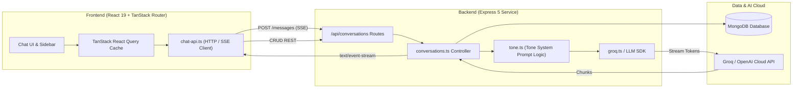

# Nexa AI — Intelligent Real-Time Chat Assistant

> **Vibe Coding Assessment Solution** | Built for real-time interaction, dynamic system instruction adaptation, and scalable full-stack state management.

---

## 📌 Table of Contents
1. [Project Overview](#-project-overview)
2. [Key Features](#-key-features)
   - [Core Requirements](#1-core-requirements)
   - [The Vibe Check (Tone Toggle)](#2-the-vibe-check-tone-toggle)
   - [Bonus Features](#3-bonus-features)
3. [System Architecture](#-system-architecture)
4. [Tech Stack](#-tech-stack)
5. [API Specification](#-api-specification)
6. [Database Schema (MongoDB)](#-database-schema-mongodb)
7. [Getting Started & Installation](#-getting-started--installation)
   - [Prerequisites](#prerequisites)
   - [1. Backend Setup](#1-backend-setup)
   - [2. Frontend Setup](#2-frontend-setup)
8. [Running Tests](#-running-tests)
9. [Viva & Technical Discussion Notes](#-viva--technical-discussion-notes)

---

## 🚀 Project Overview

**Nexa AI** is an intelligent, full-stack chat assistant engineered with real-time streaming capabilities, dynamic tone adaptation, persistent conversation history, and an accessible, responsive user interface. 

All computation, prompt construction, tone instruction enforcement, validation, and database operations are strictly processed on the **server-side**, while the **frontend** operates as a clean, reactive presentation layer.

---

## ✨ Key Features

### 1. Core Requirements

- **Interactive Chat Interface**:
  - Scrollable conversation timeline with distinct chat bubbles.
  - **User Bubbles**: Right-aligned, primary brand accented, with user avatar and formatted timestamps.
  - **AI Bubbles**: Left-aligned, muted modern surface, with AI bot avatar and formatted timestamps.
  - Smooth auto-scroll tracking incoming messages and stream deltas.

- **Real-Time Streaming View**:
  - Implements **Server-Sent Events (SSE)** delivering text delta chunks character-by-character.
  - Real-time typing cursor pulse animation.
  - Three-dot animated shimmer indicator ("Thinking...") during inference latency prior to the first token arrival.

- **Conversation History Sidebar**:
  - Collapsible side navigation showcasing all historical conversations sorted chronologically by most recent activity.
  - Thread creation via "New Chat".
  - One-click deletion with automatic state cleanup.
  - Thread selection with active highlight and persistence restoration on reload.

### 2. The Vibe Check (Tone Toggle)

Users can dynamically switch the AI's persona and tone at any point in the conversation:
- 💼 **Professional**: Formal, precise, respectful, and structured responses.
- 😊 **Casual**: Friendly, warm, natural, and conversational tone.
- ⚡ **Concise**: High-density, direct, essential-only information without fluff.

**Server-Side Mechanism**: The tone preference is stored per conversation in MongoDB and injected as a system instruction modifier to the LLM completion request on the backend (`getToneInstruction(tone)`).

### 3. Bonus Features

In addition to the mandatory problem statement requirements, two extra features have been designed and implemented:

1. **One-Click Clipboard Copy with Feedback**:
   - Every AI response features a quick-copy action button.
   - Triggers native `navigator.clipboard.writeText` and displays immediate visual confirmation (checkmark + "Copied!" tooltip).

2. **Dark / Light Theme Toggle**:
   - Seamless toggle between light and dark modes.
   - Detects system preferences (`prefers-color-scheme`) by default and persists user choice in `localStorage`.
   - Handled via Tailwind v4 dark-mode tokens and CSS variables.

3. *(Bonus)* **Response Regeneration**:
   - Re-runs the last user turn under the currently active tone without re-typing the prompt.

---

## 🏛 System Architecture



### Architectural Decisions
- **Decoupled Architecture**: Standalone Node/Express service in `server/` completely decoupled from frontend build tooling, ensuring independent deployment and scalability.
- **SSE vs. WebSockets**: Server-Sent Events (SSE) were selected over WebSockets because chat communication is fundamentally unidirectional per turn (client prompts once, server streams response). SSE is lightweight, HTTP/2-friendly, supports auto-reconnection, and avoids socket handshake overhead.

---

## 🛠 Tech Stack

| Layer | Technology | Purpose |
|---|---|---|
| **Frontend Framework** | React 19 + TypeScript | Component-based UI with modern React compiler support |
| **Routing** | TanStack Router | Type-safe client-side routing |
| **State & Data Fetching** | TanStack React Query v5 | Server-state caching, invalidation, and optimistic updates |
| **Styling & UI** | Tailwind CSS v4 + shadcn/ui | Modern styling, accessible primitives, OKLCH color design tokens |
| **Icons** | Lucide React | Clean, tree-shakeable SVG icon set |
| **Backend Framework** | Express 5 + TypeScript | RESTful API server with SSE support |
| **Database ODM** | Mongoose 8 (MongoDB) | Schema validation, lifecycle timestamps, document storage |
| **AI Inference** | Groq SDK / OpenAI SDK | Ultra-low latency streaming inference (`llama-3.3-70b-versatile`) |
| **Testing** | Vitest + Node Test Runner | Comprehensive unit testing for routing and tone transformation |

---

## 📡 API Specification

Base URL: `http://localhost:4000/api`

| Method | Endpoint | Description | Request Body | Response |
|---|---|---|---|---|
| `GET` | `/health` | Service health & MongoDB status | None | `{ "ok": true, "database": "connected" }` |
| `GET` | `/conversations` | List conversation threads | None | Array of `{ id, title, tone, createdAt, updatedAt }` |
| `POST` | `/conversations` | Create a new conversation | `{ "tone": "professional" }` | Created conversation summary object |
| `GET` | `/conversations/:id` | Retrieve thread with full messages | None | Full conversation with `messages[]` |
| `DELETE` | `/conversations/:id` | Delete conversation thread | None | `204 No Content` |
| `POST` | `/conversations/:id/messages` | Send message & stream AI reply | `{ "prompt": "Hello", "tone": "casual" }` | `text/event-stream` (SSE deltas) |
| `POST` | `/conversations/:id/regenerate` | Regenerate last AI response | `{ "tone": "concise" }` | `text/event-stream` (SSE deltas) |

### Server-Sent Event (SSE) Stream Protocol

During message streaming, the endpoint responds with standard `text/event-stream`:

```text
data: {"type":"delta","text":"Hello"}

data: {"type":"delta","text":" there! How"}

data: {"type":"delta","text":" can I assist you today?"}

data: {"type":"done"}
```

---

## 🗄 Database Schema (MongoDB)

Defined using Mongoose in [server/src/models/conversation.ts](file:///e:/Project/Quantiphi-Assignment_Rupesh-Varshney/server/src/models/conversation.ts):

```typescript
// Subdocument Schema: Message
{
  role: { type: String, enum: ["user", "assistant"], required: true },
  content: { type: String, required: true, maxlength: 100000 },
  createdAt: { type: Date, default: Date.now }
}

// Parent Document Schema: Conversation
{
  title: { type: String, required: true, maxlength: 120, default: "New chat" },
  tone: { 
    type: String, 
    enum: ["professional", "casual", "concise"], 
    required: true, 
    default: "professional" 
  },
  messages: [messageSchema],
  createdAt: { type: Date },
  updatedAt: { type: Date }
}
```

---

## 🚀 Getting Started & Installation

### Prerequisites
- **Node.js** >= 18 (Tested on v24)
- **npm** >= 9
- **MongoDB** (local instance or [MongoDB Atlas](https://www.mongodb.com/atlas) connection URI)
- **Groq API Key** (Free from [console.groq.com](https://console.groq.com)) or OpenAI API Key

---

### 1. Backend Setup

1. Open a terminal and navigate to `server/`:
   ```bash
   cd server
   ```

2. Configure environment variables:
   ```bash
   cp .env.example .env
   ```
   Open `server/.env` and supply your credentials:
   ```env
   PORT=4000
   MONGODB_URI=mongodb+srv://<username>:<password>@cluster0.mongodb.net/nexa-ai?retryWrites=true&w=majority
   GROQ_API_KEY=gsk_your_groq_api_key_here
   GROQ_MODEL=llama-3.3-70b-versatile
   CORS_ORIGIN=http://localhost:5173,http://localhost:8080
   ```

3. Install backend dependencies:
   ```bash
   npm install
   ```

4. Start the backend in development mode:
   ```bash
   npm run dev
   ```
   The backend will start at `http://localhost:4000`. You should see:
   ```
   Nexa AI API ready at http://localhost:4000
   ```

---

### 2. Frontend Setup

1. In a separate terminal, navigate to the project root:
   ```bash
   cd e:\Project\Quantiphi-Assignment_Rupesh-Varshney
   ```

2. Install root dependencies:
   ```bash
   npm install
   ```

3. Start the frontend development server:
   ```bash
   npm run dev
   ```
   Open `http://localhost:5173` (or the port output by Vite) in your browser.

---

## 🧪 Running Tests

Both the frontend and backend have automated test suites:

### 1. Backend Tone Rule Tests
Verifies that tone selection correctly compiles into strict system instructions:
```bash
npm --prefix server test
```
**Output:**
```
✔ professional tone becomes a professional system instruction
✔ casual tone becomes a casual system instruction
✔ concise tone becomes a concise system instruction
ℹ tests 3, pass 3, fail 0
```

### 2. Frontend Routing & Build Tests
Verifies TanStack Router tree resolution and asset compilation:
```bash
npm test
npm run build
```
**Output:**
```
✓ src/test/app-routing.test.tsx (1 test)
✓ built in 7.16s (.output / production ready)
```

---

## 💡 Viva & Technical Discussion Notes

During evaluation and technical review, the following core design choices can be highlighted:

1. **Separation of Concerns & Server-Side Security**:
   - No LLM keys (`GROQ_API_KEY` / `OPENAI_API_KEY`) or system instructions are ever exposed to the client bundle.
   - The frontend communicates through a clean abstraction layer (`chat-api.ts`), ensuring the UI is backend-agnostic.

2. **Tone Injection Mechanism**:
   - Tone is enforced server-side as the `system` message preceding the conversation history. This guarantees that user prompts cannot override the desired output style through prompt injection.

3. **Stream Resilience & Re-hydration**:
   - Message chunks are accumulated in local React state for instantaneous zero-latency streaming. Upon stream completion (`type: "done"`), React Query invalidates the cache to ensure the UI re-hydrates the true MongoDB-generated document ID and server timestamp.

4. **Edge-Safe Architecture**:
   - The frontend builds with Vite and Nitro into Cloudflare/Node-compatible static assets with full TypeScript typing.
